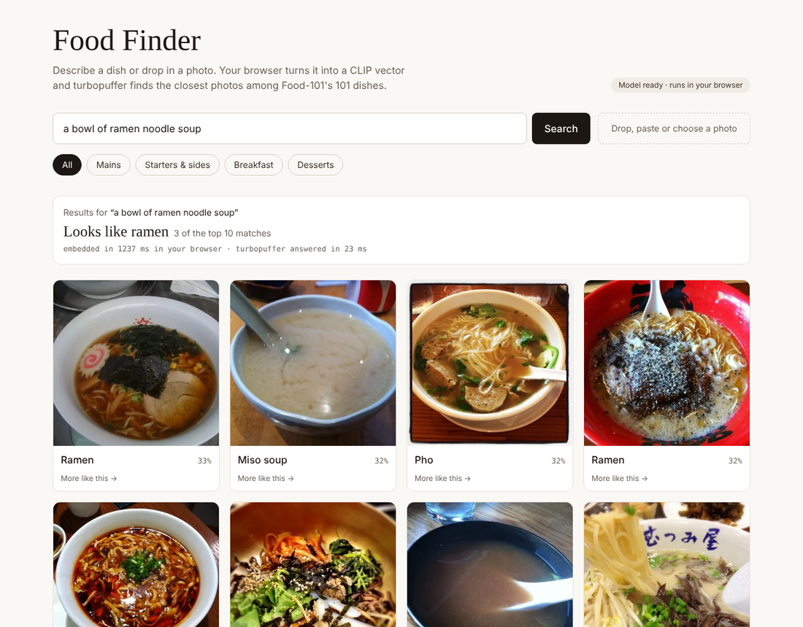
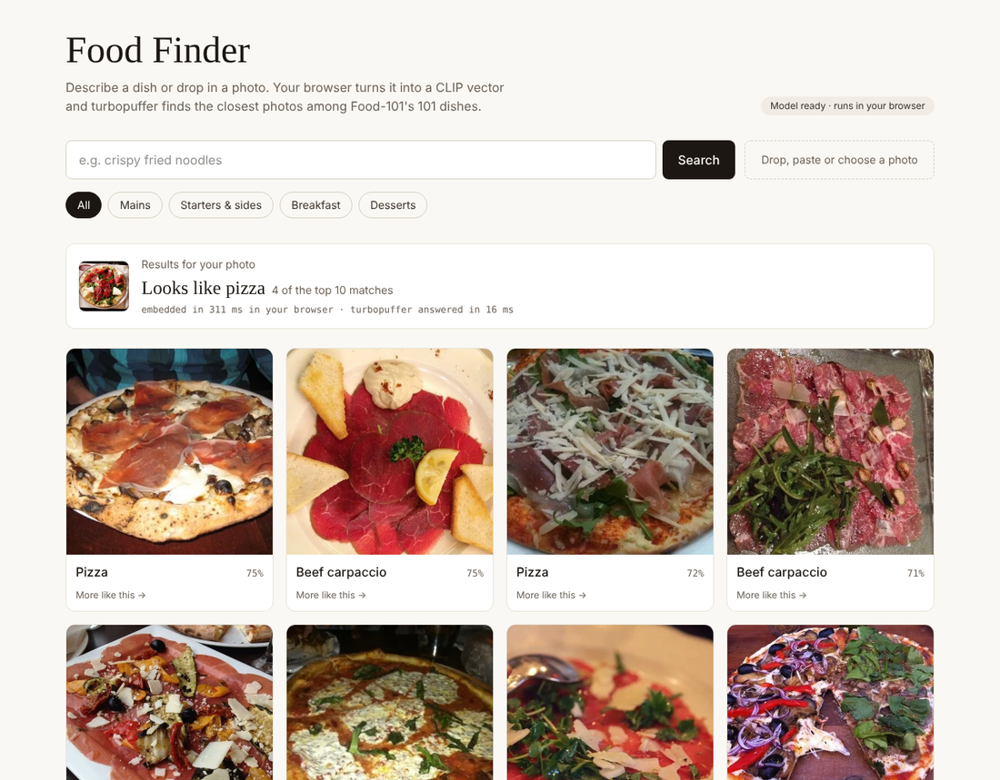

# Food Finder

Describe a dish ("crispy fried noodles") or drop in a photo, and Food Finder shows the closest matches from the
[Food-101](https://data.vision.ee.ethz.ch/cvl/datasets_extra/food-101/) dataset, with a guess at what the dish is.
The search runs on [turbopuffer](https://turbopuffer.com), the query embedding runs in your browser, and the app
is built with Next.js for Vercel.

> **Personal learning project.** I built Food Finder on my own time to learn multimodal vector search: loading a
> pre-embedded image dataset into turbopuffer and embedding text and photo queries in the browser with the matching
> CLIP model. It is not affiliated with, sponsored by or endorsed by turbopuffer, Vercel, Hugging Face, LAION,
> ETH Zürich or any employer.





## How it works

```
 Loading (once, on your laptop)                     Searching (every query)
 ─────────────────────────────                      ───────────────────────
 Food-101 on Hugging Face                           Text or photo
 (image + label + CLIP vector)                           │
        │                                                ▼
        ├─ image ──► resize to WebP ──► Vercel Blob   CLIP model in a Web Worker (in the browser)
        │                                                │  512-d vector
        └─ vector + label + course ──► turbopuffer ◄── /api/search (Vercel function, holds the key)
                                                         │
                                                         ▼
                                                   Top 24 matches + "Looks like …"
```

- **No embedding at load time.** Each Food-101 row already carries a 512-dimension
  [OpenCLIP](https://github.com/mlfoundations/open_clip) ViT-B-32 vector, so the ingest script only moves images
  and vectors.
- **Queries use the same model.** CLIP has a text encoder and an image encoder that share one vector space, so
  "ramen" and a photo of ramen land near each other. The query must go through the *same* weights that made the
  dataset's vectors (`laion2b_s34b_b79k`). OpenAI's CLIP ViT-B/32 has the same shape but different weights and
  returns noise against this data.
- **In the browser, 8-bit.** The full model is 600 MB, the 8-bit build is 150 MB. On 101 held-out photos searched
  against 3,030 indexed ones, the 8-bit model picked the right dish by top-5 vote 75 times, the same as using
  the dataset's own stored vectors as queries. The browser caches the model after the first visit, and photos
  you search with never leave your device; only the vector is sent.
- **Filters and "more like this".** Each row has a `course` attribute (mains, starters and sides, breakfast,
  desserts) for filtering. "More like this" searches with a stored row's own vector.
- **The guess.** "Looks like ramen" is a vote among the top 10 matches, with higher-ranked matches counting more.

## Project layout

| Path | What it does |
| --- | --- |
| `scripts/ingest.ts` | One-time load: Food-101 → Vercel Blob (images) → turbopuffer (vectors and attributes) |
| `lib/clip.worker.ts` | Web Worker that embeds text or a photo with CLIP (Transformers.js) |
| `lib/use-clip.ts` | React hook around the worker: model download progress and embed calls |
| `lib/search.ts` | Server-side turbopuffer queries: search by vector, more like this, the guess |
| `app/api/search/route.ts` | `POST /api/search` with `{ vector }` or `{ id }`, plus an optional `course` |
| `app/page.tsx` | The UI: search box, photo drop, course filters, results grid |
| `lib/courses.ts` | Course for each of the 101 dishes |

## Run it

You need Node 20 or later, a turbopuffer API key and a Vercel Blob store.

1. **Install.** `npm install`
2. **Add keys.** Copy `.env.example` to `.env.local` and fill it in. `.env.local` is git-ignored.

   | Name | Value |
   | --- | --- |
   | `TURBOPUFFER_API_KEY` | your turbopuffer key (required) |
   | `TURBOPUFFER_REGION` | defaults to `aws-us-east-1` |
   | `TURBOPUFFER_NAMESPACE` | defaults to `food101` |
   | `BLOB_READ_WRITE_TOKEN` | Vercel project → Storage → Blob → `.env.local` tab (only `npm run ingest` uses it) |

3. **Load the data.** `npm run ingest` loads 100 photos per dish (10,100 images, about 275 MB of WebP) in roughly
   10 to 20 minutes. Add `-- --dry-run` to read and resize without uploading anything, or `-- --per-class 30` for
   a smaller set. Re-running overwrites rather than duplicates.
4. **Start it.** `npm run dev` and open <http://localhost:3000>. The first visit downloads the model (150 MB).

## Deploy to Vercel

1. Import this repo in Vercel (**Add New → Project**). It's detected as Next.js; keep the default settings.
2. Add `TURBOPUFFER_API_KEY` (mark it sensitive), and `TURBOPUFFER_REGION` and `TURBOPUFFER_NAMESPACE` if you
   changed them. The deployed app doesn't need the Blob token; image URLs are already stored in turbopuffer.
3. Deploy.

## Costs

- **turbopuffer:** the Launch plan's $16/month minimum covers this easily.
- **Vercel:** the Hobby plan (free, non-commercial) includes 1 GB of Blob storage; this uses about 275 MB.
- **Embedding:** none. The dataset comes pre-embedded and queries are embedded in the visitor's browser.

## Data and credits

- Photos: Food-101, Bossard, Guillaumin and Van Gool, *Food-101: Mining Discriminative Components with Random
  Forests*, ECCV 2014. The images come from foodspotting.com and belong to their owners; they're shown here for a
  non-commercial demo only. Loaded from the Lance-format copy at
  [lance-format/food101-lance](https://huggingface.co/datasets/lance-format/food101-lance).
- Embeddings: OpenCLIP ViT-B-32 trained on LAION-2B
  ([laion/CLIP-ViT-B-32-laion2B-s34B-b79K](https://huggingface.co/laion/CLIP-ViT-B-32-laion2B-s34B-b79K)); the
  browser uses the ONNX export
  [onnx-community/CLIP-ViT-B-32-laion2B-s34B-b79K-ONNX](https://huggingface.co/onnx-community/CLIP-ViT-B-32-laion2B-s34B-b79K-ONNX)
  through [Transformers.js](https://huggingface.co/docs/transformers.js).
- The course grouping in `lib/courses.ts` is mine, not part of Food-101.
